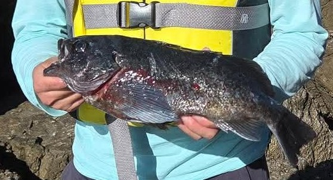
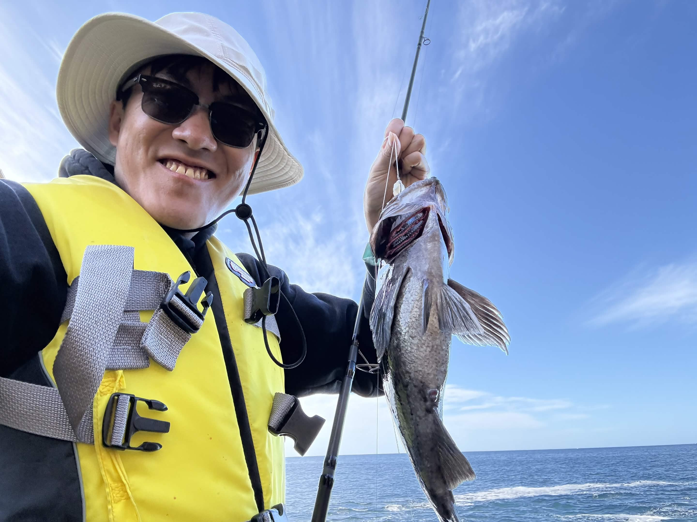

Apologies for the lack of reports!! Not that I haven't been doing any fishing, I've just been pretty bad about writing up my trips. The past two weeks I've been exploring the Carmel cliffs --- for whatever reason, the waves and wind have been especially calm for this time of year, so I decided to take advantage.

The blue rockfish seem to have agreed. I kept my limit of 10 blues on my first trip, and 8 on the second. And they weren't bad fish --- one was actually my PB blue rockfish.

<table>
    <tr>
        <th></th>
        <th></th>
    </tr>
    <tr>
        <th>My PB blue rockfish</th>
        <th>One of the larger blues.</th>
    </tr>
</table>

All of the catches were on squid on a high-low rig. I recently started using <a href="https://link.amazon/B00duFmp7">Dave's Tangle Free Round Weights</a> as a lead-free sinker for ocean fishing, which seems to have been working quite well. In particular, lead-free options in heavier sizes are hard to come by, so I decided to give their 3oz version a try. While they are pricey, they cast really well and let me get pretty good distance from shore. They also don't seem to snag too much, but that could just be confirmation bias :)

Unfortunately, it seems that some big winter surf is coming, and the rocks may not be particularly fishable for a while. Glad I was able to get out before Mother Nature showed her full fury. In other news, trout season is starting --- Los Vaqueros and EBRPD just did their first stocks of the year! Stay tuned for reports :) 